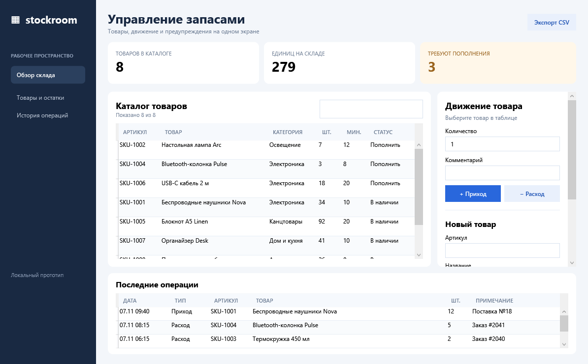

# Stockroom — WPF inventory demo

A small Windows desktop prototype for tracking products and stock movements in a retail store. It runs locally and needs no server or account.



## Features

- Product catalog with SKU, category, quantity, minimum stock, and live search.
- Receive and ship stock with a movement history and optional notes.
- Low-stock counter and per-product status.
- Add products and export the catalog as UTF-8 CSV.
- Local JSON persistence in `inventory.json` beside the executable. The first launch creates sample data.

## Run

Install the [.NET 8 Desktop Runtime](https://dotnet.microsoft.com/download/dotnet/8.0) on Windows, then build and run:

```powershell
dotnet run --project .\RetailStockDesk.csproj
```

For a Release build:

```powershell
dotnet publish .\RetailStockDesk.csproj -c Release -r win-x64 --self-contained false -o .\publish
.\publish\RetailStockDesk.exe
```

Select a product, enter a quantity, then use **Приход** or **Расход**. The application prevents negative stock. To restart the sample, close the app and delete `inventory.json` next to the executable.

## Scope

This is a single-user portfolio prototype. A production system would add a shared database, user roles, concurrent updates, suppliers, and audit controls.
